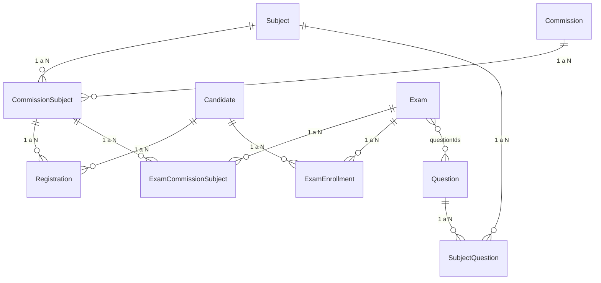

# Entidades de Aki

El código y la base están en inglés. La interfaz está en español. Esta tabla es la traducción. Si una palabra de abajo no aparece, no la inventes.

| En la pantalla | En el código | Tabla |
| --- | --- | --- |
| Alumno | `Candidate` | `users` con rol `Candidate`, más `candidate_profiles` |
| Docente | `Teacher` | `users` |
| Admin | `Admin` | `users` |
| Materia | `Subject` | `subjects` |
| Comisión | `Commission` | `commissions` |
| Comisión de materia | `CommissionSubject` | `commission_subjects` |
| Cursado | `Registration` | `registrations` |
| Examen | `Exam` | `exams` |
| Examen en una comisión de materia | `ExamCommissionSubject` | `exam_commission_subjects` |
| Inscripción al examen | `ExamEnrollment` | `exam_enrollments` |
| Pregunta | `Question` | `questions` |
| Pregunta de una materia | `SubjectQuestion` | `subject_questions` |
| Legajo | `users.username` del alumno | `users.username` |

`Registration` no es `ExamEnrollment`. El cursado dice qué alumno cursa una materia en una comisión. La inscripción dice si ese alumno puede rendir un examen.

## Relaciones

- Una materia y una comisión pueden existir solas. `CommissionSubject` es el vínculo, unique `(commission_id, subject_id)`.
- Un cursado pertenece a una sola `CommissionSubject`. Unique `(candidate_id, commission_subject_id)`. Un alumno no tiene dos cursados de la misma materia.
- Un examen no se guarda sin al menos un `ExamCommissionSubject`. Todos los de ese examen son de la misma materia.
- Una pregunta no tiene curso ni materia obligatoria. Puede estar en varias materias. El examen la elige por `questionIds`.
- Borrar una materia no borra comisiones, preguntas ni exámenes. Si todavía hay un `CommissionSubject`, un cursado o un examen usándola, el borrado se rechaza. Lo mismo al revés.
- La inscripción manual a un examen no crea un cursado. El link de inscripción sí: crea el alumno si no existe, el cursado de esa `CommissionSubject` y la fila de `ExamEnrollment`.

## Links de un examen

- Vista previa y rendir: lo abre el docente que creó el examen o un admin mientras está en borrador, sin crear attempt. Publicado, lo abre un alumno inscripto. Un alumno inscripto puede ver un examen en borrador en su lista, pero no puede rendirlo ni crear attempt hasta que se publique.
- Inscripción: un token por cada `ExamCommissionSubject`. Legajo y contraseña. Si el legajo no existe, se crea el alumno. Si ya cursa esa materia en otra comisión, no se lo mueve.

## Acceso

No hay filtro por red. Si la política "restringir acceso simultáneo" está prendida, el attempt guarda el dispositivo del login. Otro dispositivo no inicia. El docente revoca subiendo `users.auth_epoch` y soltando ese id. Las respuestas quedan.
